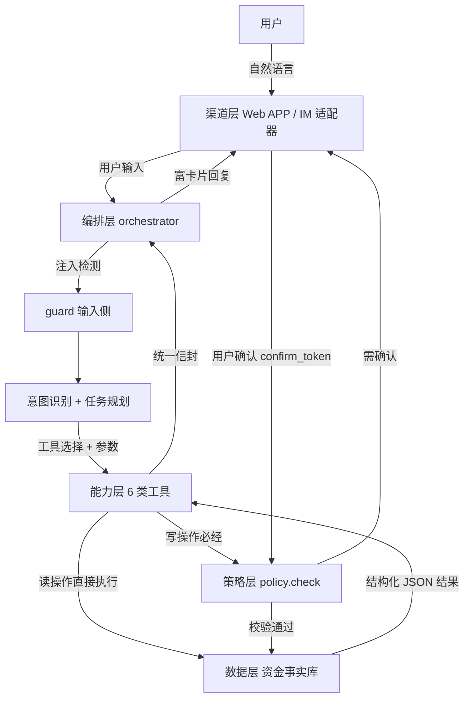

# 系统架构设计 · 02_ARCHITECTURE.md

> 《引金据典》——有据可依的银行智能体
> 版本：v1.0 ｜ 编制：2026-10-29 ｜ 依据：docs/00_CONSTITUTION.md、docs/01_PRD.md

---

## 1. 架构总览

### 1.1 设计总则

**模型只提出"意图与参数"，永远不能直接执行交易。** 所有写操作由能力层工具函数在策略层校验与用户确认后执行，模型输出永远不是执行指令。安全策略横切全链路。

### 1.2 五层架构图

```
┌─────────────────────────────────────────────────────────────┐
│ 渠道层   Web APP（对话 / 看板 / 安全中心）· IM 适配器（可扩展）    │
└───────────────────────────────┬─────────────────────────────┘
                                 │ 用户输入 / 富卡片回复
┌───────────────────────────────▼─────────────────────────────┐
│ 编排层 orchestrator                                            │
│  注入检测 → 意图识别 → 上下文与指代消解 → 任务规划              │
│  → 工具选择与参数填充 → 回复生成（确认卡 / 回执卡）              │
└───────────────────────────────┬─────────────────────────────┘
                                 │ 意图 + 参数（非执行指令）
┌───────────────────────────────▼─────────────────────────────┐
│ 能力层 6 类工具                                                │
│  transfer · bill · wealth · card · subscription · profile     │
│  统一信封 {"ok","data","error","source","ts"}                  │
└───────────────────────────────┬─────────────────────────────┘
                                 │ 写操作必经
┌───────────────────────────────▼─────────────────────────────┐
│ 策略层 policy                                                  │
│  权限分级 L0–L3 · 风控规则 · 合规校验 · 审计留痕                │
│  所有写操作：policy.check() → confirm_token → 审计             │
└───────────────────────────────┬─────────────────────────────┘
                                 │
┌───────────────────────────────▼─────────────────────────────┐
│ 数据层                                                        │
│  资金事实库（SQLite）· 审计日志 · 用户画像                     │
└─────────────────────────────────────────────────────────────┘
```

### 1.3 Mermaid 架构与数据流图



---

## 2. 分层详解

### 2.1 渠道层

| 组件 | 职责 |
|---|---|
| Web APP | 对话主界面、资金事实库看板、习惯画像与推荐页、安全中心页 |
| IM 适配器 | 统一消息协议，可接入企业微信等 IM 渠道（本期以 Web 为主） |
| 富卡片渲染 | 确认卡、账单卡、理财卡、订阅卡、卡片管理卡、权限拦截卡 |

### 2.2 编排层（orchestrator）

| 子模块 | 职责 |
|---|---|
| 意图识别 | 单意图/多意图/闲聊/越界 分类，输出结构化意图 JSON |
| 上下文与指代消解 | 维护会话实体槽位（最近交易/卡片/订阅），解析"那笔/就是那个" |
| 任务规划 | 拆子任务 + 定依赖 + 标风险级，输出任务状态机 |
| 工具选择与参数填充 | 把意图映射到能力层工具，校验参数完整性 |
| 回复生成 | 生成自然语言 + 确认卡/回执卡（数字只引用工具返回值） |

### 2.3 能力层（6 类工具）

| 工具 | 功能 |
|---|---|
| transfer | 按人名/手机号/备注转账、定时转账、AA 拆分 |
| bill | 分类统计、异常识别、月/年报告 |
| wealth | 风险评估、产品推荐对比、申购/赎回 |
| card | 查卡、额度调整、冻结/解锁、挂失 |
| subscription | 识别扣费、续费提醒、取消订阅 |
| profile | 行为信号采集、意图预判、推荐生成 |

所有工具返回统一信封：

```json
{"ok": true, "data": {...}, "error": null, "source": "bill", "ts": "2026-10-29T10:00:00+08:00"}
```

### 2.4 策略层（policy）

- **权限分级**：L0–L3 判定（详见《安全设计文档》）
- **风控规则**：金额阈值、白名单、黑名单、短时窗口聚合
- **合规校验**：理财推荐三红线、风险测评通过校验
- **审计**：所有写操作写审计日志

### 2.5 数据层

| 数据 | 说明 |
|---|---|
| 资金事实库 | 账户、卡片、流水、订阅、理财持仓（SQLite + 演示数据） |
| 审计日志 | who/what/when/how much/策略依据/确认原文 |
| 用户画像 | 行为信号、预判规则、推荐记录 |

---

## 3. 一次完整交易的数据流（时序）

以"转账 2000 给王伟"为例：

```
1. 用户输入 → 渠道层 → 编排层
2. guard 注入检测：通过
3. 意图识别：intent=transfer, 参数{收款人=王伟, 金额=2000}
4. 任务规划：单任务，风险级=L3（>500 需二次确认）
5. 工具选择：transfer.execute
6. policy.check()：金额>500 → 需二次确认，生成 confirm_token
7. 回复确认卡："将向 王伟 转账 ¥2,000，是否确认？"
8. 用户确认 → 携带 confirm_token 重入
9. policy 校验 token + 额度 + 白名单 → 通过
10. transfer.execute 写库 → 回执 + 30 秒撤销窗口
11. 写审计日志 → 更新用户画像
```

**关键点**：第 5 步模型只产出"意图 + 参数"，第 6–10 步由确定性代码完成，模型不参与执行。

---

## 4. 技术栈选型

| 层 | 技术 | 选型理由 |
|---|---|---|
| 前端 | React + TypeScript + Vite + Tailwind CSS | 组件化、富卡片渲染、快速开发 |
| 后端 | Python + FastAPI | 类型清晰、异步、与 Agent 编排契合 |
| 数据库 | SQLite | 零依赖、内置演示数据、可离线 |
| Agent 编排 | 自研轻量流程 | 完全掌控安全边界，不依赖重框架 |
| 大模型接入 | OpenAI 兼容接口（可配置） | 多模型可切换，支持离线降级 |

---

## 5. 离线降级方案

系统内置规则引擎，当 `OFFLINE_MODE=true` 或网络不通时：

| 环节 | 在线模式 | 离线模式 |
|---|---|---|
| 意图识别 | 大模型 | 规则 + 关键词匹配 + 正则 |
| 参数抽取 | 大模型 | 规则槽位提取 |
| 回复生成 | 大模型 | 模板话术 |
| 工具/策略/数据 | 确定性代码 | 不变 |

切换方式：`.env` 中 `OFFLINE_MODE` 一个开关。保证评审环境在无 Key、断网情况下可完整演示全部五场景。

---

## 6. 一页纸架构摘要（200 字）

《引金据典》采用"渠道—编排—能力—策略—数据"五层架构。大模型仅负责意图理解、参数抽取与自然语言叙述，所有写操作由能力层工具函数在策略层校验与用户确认后执行，模型输出永远不是执行指令。安全策略横切全链路：输入侧做注入检测、工具侧做参数白名单、输出侧做数字溯源校验，权限按 L0–L3 分级并全程审计留痕。系统内置规则引擎降级方案，在无外部大模型或断网时仍可完整演示全部五个场景。

---

*本文档与 docs/00_CONSTITUTION.md 冲突时，以宪法为准。*
